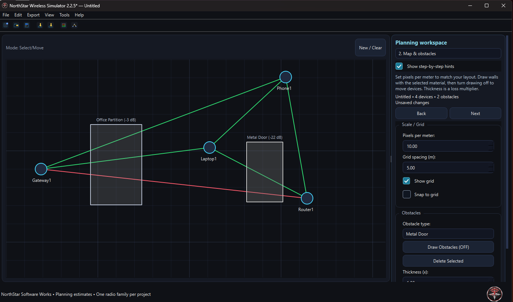
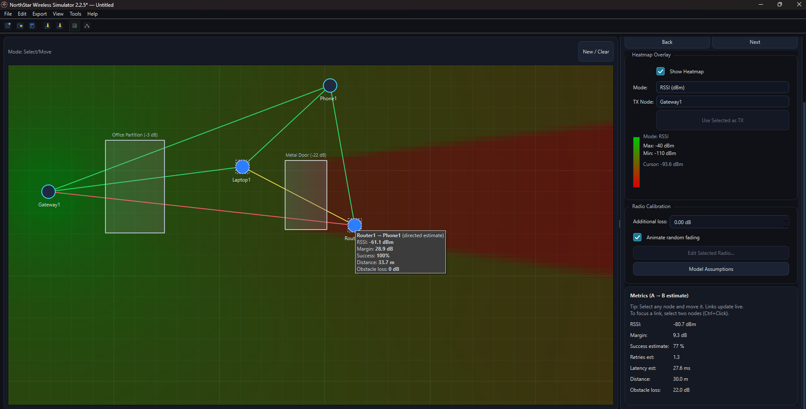

# NorthStar Wireless Simulator

### A message from Kristopher

Thank you for taking an interest in my work. I provide the source code so you can explore how the application works and modify it for your own projects under the included terms.

If you would rather jump right in, visit [NorthStar Software Works](https://northstarsoftwareworks.com) to purchase the Windows installer and start using the application without setting up Python or building it yourself.

Every purchase helps me continue developing and improving my software, maintain the equipment I use, and keep creating practical, affordable tools. Thank you for supporting independent development.

— **Kristopher Sorensen · NorthStar Software Works**

<p align="center">
  
</p>

<p align="center">
  <strong>Explore wireless placement, coverage, and obstacles before testing your real equipment.</strong><br>
  <a href="https://northstarsoftwareworks.com">Visit NorthStar Software Works · Purchase the Windows installer</a>
</p>

## About the application

NorthStar Wireless Simulator is a local desktop application for exploring how device placement, radio settings, distance, and obstacles affect estimated wireless links. Build a layout, place devices or modules, add obstacles, and compare signal strength, link margins, and coverage using an interactive map.

Use it for early project planning, prototype experiments, demonstrations, and learning about simplified RF propagation. Projects stay on your computer, and normal simulator use works offline.

## Screenshots

**Device placement and obstacles**



**Coverage heatmap and link estimates**



## Features

- **Guided planning:** Five stages cover devices, maps and obstacles, coverage and calibration, routes and placement, and review/save/export. Jump between stages or hide the hints.
- **Wireless presets:** Explore Wi-Fi at 2.4, 5, and 6 GHz; Bluetooth Classic; BLE 1M, 2M, and Coded; XBee/Zigbee; RM024/FHSS; sub-GHz FSK at 868/915 MHz; and an illustrative LoRa 915 MHz preset.
- **Devices and modules:** Choose sensors, gateways, routers, access points, phones, laptops, Wi-Fi/Bluetooth/BLE/Zigbee/LoRa/RF modules, development boards, transceivers, test nodes, and more.
- **Your project names:** Name devices when adding them or rename them later. Custom names survive device-type changes and project saves. Renaming supports Undo/Redo.
- **Obstacle options:** Model drywall, concrete, metal, glass, wood, brick, reinforced concrete, metal doors, partitions, furniture, storage racks, machinery, people, foliage, and water tanks using rectangular obstacles and scalable loss.
- **Radio adjustments:** Edit per-device power, sensitivity, frequency, path-loss parameters, and fading settings without changing the original presets.
- **Coverage and link review:** View heatmaps, directed signal and margin estimates, illustrative success/retry/latency estimates, and a review of displayed link margins.
- **Placement experiments:** Compare abstract multi-hop paths and suggested router positions. Use the grid and snapping to organize layouts.
- **Local projects and exports:** Save/load JSON projects, recover work through periodic recovery saves, and export map images and Excel snapshots.

## Quick start: run the source

Download or clone the repository and place the complete project in a writable folder. The Windows scripts expect the source files and assets to stay together.

1. Install **64-bit Python 3.11, 3.12, or 3.13** with the Windows Python launcher.
2. Run **`01_Setup_Environment.bat`** to create the virtual environment and install dependencies. Internet access is required for setup.
3. Run **`02_Run_App.bat`** and review the application terms.
4. Load a demo, or choose **Start Blank Project** and select a radio family and map scale.
5. Choose a device type and radio profile, optionally enter a project name, and select **Add Node**.
6. Arrange devices, draw obstacles, explore coverage, and save or export your results.

The device type describes the item; its **radio profile** determines the modeled wireless technology. Each project uses one compatible radio family.

See the [User Guide](docs/User_Guide.md) for the full workflow and model assumptions. Prefer a ready-to-install application? [Purchase the Windows installer from NorthStar Software Works](https://northstarsoftwareworks.com).

## Developer and build tools

| Script | Purpose |
| --- | --- |
| `01_Setup_Environment.bat` | Create the virtual environment and install runtime/build dependencies |
| `02_Run_App.bat` | Launch the source application |
| `03_Quality_Checks.bat` | Run Ruff, formatting checks, Mypy, and Pytest |
| `04_Build_Exe.bat` | Run normal checks, build with PyInstaller, and run the packaged self-check |
| `05_Build_Installer.bat` | Build the Windows setup executable with Inno Setup 6 |
| `06_Build_Release.bat` | Run the release workflow, optional signing, and checksum generation |
| `07_Layout_Stress_Tests.bat` | Run optional narrow-sidebar and oversized-font checks separately |

Use the included environment for checks; the setup script installs the development tools into `.venv`. The PyInstaller output is a **one-folder distribution**: keep its files together. Installer builds require Inno Setup 6. Signing requires your own configured certificate and Windows signing tools.

The normal quality workflow runs **55 functional and normal-window tests**. Three additional layout stress tests run separately and do not block the normal build. The included [Validation Report](docs/Validation_Report.md) records the Linux checks performed for version 2.2.5; it does not claim Windows build verification. Test your compiled app and installer on Windows before distributing them.

## Project structure

| Folder | Contents |
| --- | --- |
| `northstar_wireless/domain/` | Radio definitions, presets, and link-budget calculations |
| `northstar_wireless/services/` | Propagation, project storage, resource paths, and self-checks |
| `northstar_wireless/ui/` | Map items, controls, guided workspace, editors, theme, and Undo/Redo commands |
| `assets/` | NorthStar branding and application icons |
| `examples/` | Sample JSON projects |
| `scripts/`, `packaging/` | Windows setup, build, signing, and installer workflows |
| `tests/`, `docs/` | Automated checks, user guide, architecture, and release documentation |

## Simulation assumptions

Results are estimates from a simplified propagation model. Radio and obstacle presets are illustrative; use measurements and your equipment's specifications to calibrate an experiment. Success, retries, and latency are heuristic estimates.

The application does not scan or control hardware, emulate complete Wi-Fi/Bluetooth protocols, or predict throughput and channel contention. Device labels and abstract routes do not give real devices mesh or relay capabilities. Validate your design with actual equipment and on-site testing.

## Terms and support

Source availability does not by itself grant permission to redistribute or resell the application, packaged builds, or NorthStar branding. Review the included [End User Terms](docs/EULA.txt) and [Third-Party Notices](docs/THIRD_PARTY_NOTICES.md) for applicable terms.

Created by **Kristopher Sorensen · NorthStar Software Works**. Branding artwork was created with AI assistance.

**Website:** [northstarsoftwareworks.com](https://northstarsoftwareworks.com)


## Build behavior in 2.2.5

Build checks target application and test files and exclude third-party packages in `.venv`. Run **01_Setup_Environment.bat**, then **04_Build_Exe.bat**. The normal build retains lint, formatting, type checks, and all 55 functional/normal-window tests, then creates and self-checks the executable.

**07_Layout_Stress_Tests.bat** runs three optional forced narrow-sidebar/oversized-font checks. They can still report a Windows layout limitation at an artificially constrained 300-pixel sidebar. Failures retain their diagnostics and are not reclassified as passes.

Running `python -m pytest -q` directly includes every test. For normal checks, use **03_Quality_Checks.bat**, or:

```powershell
.venv\Scripts\python.exe -m pytest -q -m "not layout_stress"
```

After testing the compiled application, **05_Build_Installer.bat** builds the installer. Keep the complete PyInstaller distribution folder together.

## Uploading this package to GitHub

Extract the ZIP and upload the contents of this project folder to the root of your repository. Keep `README.md`, `main.py`, `northstar_wireless/`, `assets/`, and the build scripts at the same level. Screenshot links use paths inside the repository and work without external image hosting.

This package contains source, assets, examples, tests, and build tools. It does not contain a prebuilt Windows installer, virtual environment, signing certificate, or private key. The included `.gitignore` excludes generated build output and private signing files.
